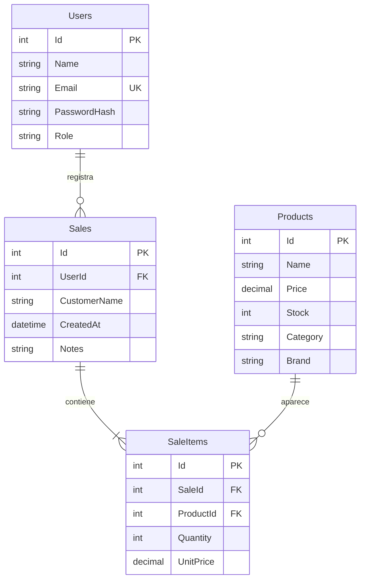

# Arquitectura de SportHub

La web React y la app React Native consumen una API REST de ASP.NET Core 10 con controladores. La API valida JWT, autoriza operaciones y persiste los datos mediante Entity Framework Core 10 en SQLite. Node ejecuta Vite y Metro durante el desarrollo; el backend se ejecuta en .NET.

## Modelo de cuatro tablas

Sales y Products forman una relación N:M mediante SaleItems. El índice único SaleId + ProductId evita repetir un producto en una venta. Borrar una venta elimina sus detalles y repone stock dentro de la misma transacción. Un producto relacionado con ventas no se puede eliminar. Users.Email es único y se normaliza a minúsculas al registrar.

## Distribución del código

- Models/Entities.cs contiene las cuatro entidades.
- Contracts/Requests.cs define los datos aceptados y sus validaciones.
- Data/AppDbContext.cs configura relaciones, restricciones e índices.
- Data/SeedData.cs carga los ejemplos de Development de forma transaccional.
- Controllers/AuthController.cs registra usuarios, valida contraseñas y emite JWT.
- Services/TokenService.cs crea tokens firmados con duración de una hora.
- Controllers/ProductsController.cs gestiona el catálogo compartido y sus permisos.
- Controllers/SalesController.cs gestiona las ventas de la cuenta actual y el stock.
- web/src/api.js y mobile/src/api.js centralizan las solicitudes HTTP.

## Seguridad aplicada

Se usa PasswordHasher de ASP.NET Core para almacenar hashes con sal. Los endpoints del dominio exigen JWT. La API comprueba emisor, audiencia, firma y vencimiento, y usa el identificador del token para filtrar ventas. Crear cuentas no permite elegir Admin. Los DTO evitan aceptar UserId, Role, Total o UnitPrice de los clientes en ventas. Los endpoints de autenticación limitan intentos por IP. CORS permite solo los orígenes web configurados; no es el mecanismo de seguridad para clientes nativos.

En Development una clave JWT aleatoria se guarda en .local/jwt.key y los datos en .local/sporthub.db. Esa carpeta está excluida por Git. Para otros entornos se exige Jwt__Key con al menos 32 bytes; configura también Jwt__Issuer, Jwt__Audience y ConnectionStrings__Default si corresponde. No hay un endpoint público para promocionar usuarios a Admin. Fuera de Development no se cargan las cuentas demo; el alta de un administrador inicial debe hacerse por un procedimiento de despliegue controlado.

La demostración utiliza HTTP en la red local. Un despliegue público requiere HTTPS y gestión de secretos. No se implementa refresh token ni revocación anticipada del JWT. En web el token vive en memoria y en Android se usa SecureStore.

## Persistencia y alcance

El script SQL se genera con Database.GenerateCreateScript. EnsureCreated sirve para crear esta versión de la base y no aplica cambios futuros de esquema. No se incluyen tablas de migraciones ni ASP.NET Identity. Las cuatro entidades son el modelo de negocio; sqlite_sequence es metadato interno de SQLite.

El inventario es compartido, las ventas son privadas de cada cuenta y no se transmiten cambios en tiempo real. Los precios usan decimal y dos decimales; los importes se presentan en bolivianos. Las fechas se guardan en UTC y los clientes las presentan en su horario local.
